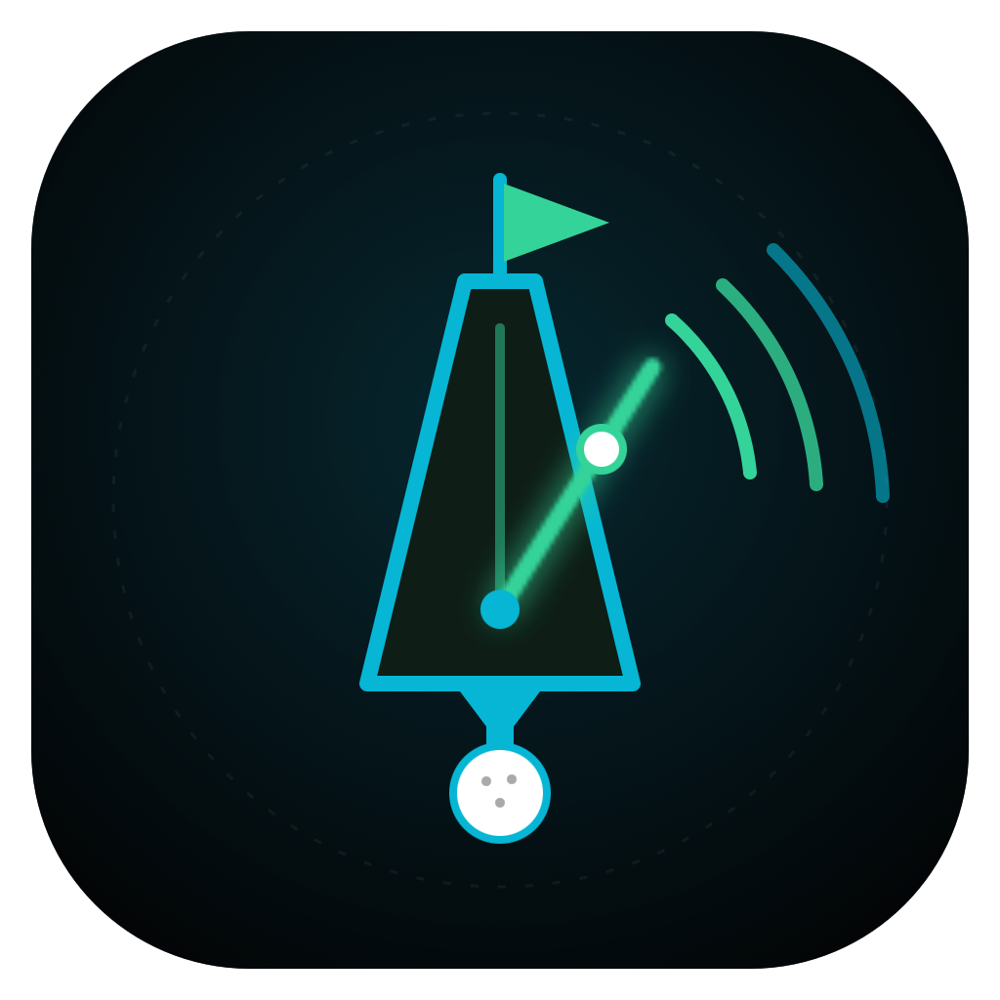

<p align="center">
  
</p>

<h1 align="center">Golf Tempo Trainer</h1>

<p align="center">
  
  
  
  
  
  
</p>

<p align="center">
  Train a consistent golf swing tempo with visual, audio, and haptic cues.
</p>

## About the app

Golf Tempo Trainer is a native iPhone app that guides the phases of your swing
with configurable intervals. It lets you practice the relationship between
backswing and downswing, follow repetition-based workouts, and review your
locally saved history.

- **Platform:** iOS 18 or later.
- **Interface:** SwiftUI with an MVVM architecture.
- **Timing:** `SwingTempoEngine` and a monotonic clock; animations do not
  determine the intervals.
- **Audio and haptics:** AVFoundation and Core Haptics.
- **Persistence and charts:** SwiftData and Swift Charts.
- **External dependencies:** none.

## Features

### Tempo trainer

- Three cues per swing: backswing start, transition/downswing start, and impact.
- Animated visual indicator for the current phase and time remaining.
- Swing counter and controls to start, pause, resume, and stop.
- Keeps the screen awake while a workout is in progress.
- Lets you choose a tempo and set the total duration between 750 and 3000 ms.

### Tempos

The available backswing-to-downswing ratios are `2:1`, `2.5:1`, `3:1`, `3.5:1`,
and `4:1`. The default is **3:1**, with a total duration of **1250 ms**:
approximately 938 ms for the backswing and 312 ms for the downswing.

The duration is divided proportionally to preserve the selected ratio. Phases
are represented in whole milliseconds and always add up to the selected total
duration.

### Workouts

Included guided sessions:

| Session | Repetitions |
|---|---:|
| Warm-up | 10 swings |
| Tempo control | 20 swings |
| Consistency | 30 swings |
| Advanced training | 50 swings |

Free mode lets you adjust the ratio from `2:1` to `4:1` in `0.5` increments,
the number of repetitions, and the rest time between swings.

### Cues and settings

- Short, distinct tones for the backswing, transition, and impact.
- Volume control and an option to turn off sound.
- Optional vibration with distinct intensities and patterns.
- Silent mode retains the visual indicator and counter.
- Local preferences for cues and the initial duration.

### History and statistics

When a session is completed, its date, tempo, duration of each phase, number of
swings, total duration, and workout type are saved locally. The dashboard shows
total swings, accumulated training time and sessions, most-practiced tempo,
daily progress, and session distribution by tempo.

## Project structure

```text
ios/
├── App/
│   ├── Components/       # Reusable phase indicators
│   ├── Persistence/      # SwiftData model and repository
│   ├── ViewModels/       # Presentation state and logic
│   └── Views/            # Home, trainer, workouts, statistics, and settings
├── Sources/GolfTempoTrainer/
│   ├── Audio/            # Sound and vibration
│   ├── Models/           # Tempo, configuration, and sessions
│   └── Services/         # Tempo engine decoupled from the interface
├── Tests/                # Engine and model tests
├── spec/                 # Specifications
└── GolfTempoTrainer.xcodeproj
```

The Xcode project compiles the files in `Sources/` directly alongside the app.
Swift Package Manager uses the same core to run tests independently of the
interface.

## Open, run, and test

### Xcode

Open `GolfTempoTrainer.xcodeproj`, choose the **GolfTempoTrainer** scheme and an
iPhone simulator, then press **⌘R**.

### Terminal

From the repository root:

```sh
# Run the engine and model tests
swift run --package-path ios GolfTempoTrainerTests

# Build for the simulator
xcodebuild \
  -project ios/GolfTempoTrainer.xcodeproj \
  -scheme GolfTempoTrainer \
  -destination 'platform=iOS Simulator,name=iPhone 17' \
  CODE_SIGNING_ALLOWED=NO \
  build
```

To install it on a physical iPhone, open the project in Xcode, connect your
device, and select a development team under **Signing & Capabilities**.

## Current scope

The app includes the training flow, guided and free workouts, local
persistence, statistics, and settings described above. Haptic feedback
requires a compatible device; final audio and vibration behavior should be
validated on a physical iPhone.
